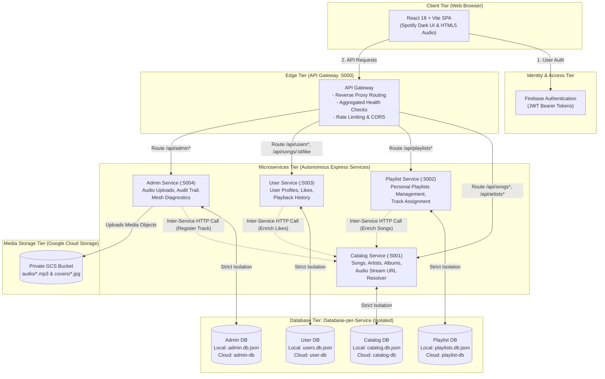
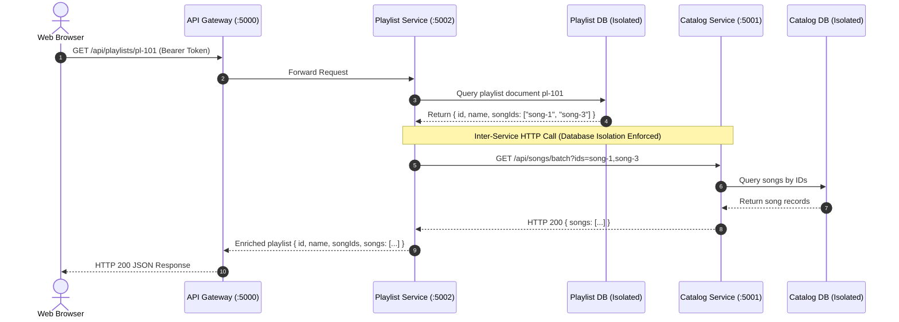

# 🎵 CloudTune — Microservices Architecture & Database-per-Service Model

## 1. Architectural Transition: Monolith to Microservices

CloudTune has been architected and converted into a **decoupled Microservices Architecture** adhering strictly to the enterprise **Database-per-Service** design pattern.

### Architecture Comparison

| Architectural Dimension | Initial Monolith | CloudTune Microservices Architecture |
|---|---|---|
| **Service Boundaries** | Single monolithic Express server process | 4 Autonomous Domain Microservices + 1 Edge API Gateway |
| **Database Model** | Shared single store / database instance | **Database-per-Service**: 100% physically isolated databases |
| **Coupling** | Direct in-memory code imports across modules | Decoupled HTTP REST inter-service communication |
| **Scalability** | Scale whole app together | Independent elastic scaling per microservice (0 to N on Cloud Run) |
| **Fault Isolation** | Failure in one domain crashes entire server | Isolated fault domains; resilience fallbacks across services |
| **Containerization** | Single container | Multi-container Docker Compose & multi-service Cloud Run deployment |

---

## 2. Microservices Topology & Data Flow



---

## 3. Microservice Specifications & Database Isolation

### A. API Gateway (Port `5000`)
- **Role**: Reverse proxy router, SSL/CORS termination, client rate limiting, and distributed health aggregator.
- **Routing Rules**:
  - `/api/songs/:id/like` $\rightarrow$ User Service (`http://localhost:5003`)
  - `/api/songs*`, `/api/artists*`, `/api/albums*` $\rightarrow$ Catalog Service (`http://localhost:5001`)
  - `/api/playlists*` $\rightarrow$ Playlist Service (`http://localhost:5002`)
  - `/api/users*` $\rightarrow$ User Service (`http://localhost:5003`)
  - `/api/admin*` $\rightarrow$ Admin Service (`http://localhost:5004`)
  - `/uploads*` $\rightarrow$ Static media asset streaming with HTTP 206 Partial Content range seeking.
  - `/api/health` $\rightarrow$ Distributed Aggregator that queries all microservices and verifies their isolated databases.

### B. Catalog Microservice (Port `5001`)
- **Domain**: Songs catalogue, search filtering, genre browsing, artists, albums, audio signed URL generation.
- **Isolated Database**: `catalog.db.json` (Local) / `catalog-db` Firestore namespace.
  - Collections: `songs`, `artists`, `albums`.
  - **Isolation Guarantee**: Zero knowledge of users, likes, playlists, or audit logs.
- **Inter-Service Endpoint**: `GET /api/songs/batch?ids=...` and `GET /api/songs/:id` allowing other microservices to query track metadata over REST.

### C. Playlist Microservice (Port `5002`)
- **Domain**: User playlists creation, deletion, renaming, track addition/removal.
- **Isolated Database**: `playlists.db.json` (Local) / `playlist-db` Firestore namespace.
  - Collections: `playlists`.
  - **Isolation Guarantee**: Stores only `songIds: string[]`. Cannot directly access or modify the Catalog database.
- **Inter-Service Communication**: When returning a playlist (`GET /api/playlists/:id`), it makes an HTTP call to the Catalog Service to fetch track details.

### D. User Microservice (Port `5003`)
- **Domain**: User accounts/profiles, user song likes (`/users/me/likes`), playback history (`/users/me/history`).
- **Isolated Database**: `users.db.json` (Local) / `user-db` Firestore namespace.
  - Collections: `users`, `likes`, `history`.
  - **Isolation Guarantee**: Cannot query or connect to Catalog or Playlist databases.
- **Inter-Service Communication**: When returning liked tracks, queries Catalog Service via HTTP to enrich song metadata.

### E. Admin Microservice (Port `5004`)
- **Domain**: Admin authentication, multipart audio and cover artwork uploads, GCP Cloud Storage synchronization, audit trail logging, and cluster statistics aggregation.
- **Isolated Database**: `admin.db.json` (Local) / `admin-db` Firestore namespace.
  - Collections: `auditLogs`.
- **Inter-Service Communication**: Calls Catalog Service over HTTP to register uploaded songs, and calls User Service to collect user statistics.

---

## 4. Sequence Diagram: Inter-Service Communication

### Example: Playlist Track Retrieval (`GET /api/playlists/:id`)



---

## 5. Deployment Topology

### A. Local Development
Run all microservices + API Gateway simultaneously:
```bash
npm run dev
# Starts Catalog (5001), Playlist (5002), User (5003), Admin (5004), and Gateway (5000)
```

Run microservices independently:
```bash
npm run start:gateway   # API Gateway on 5000
npm run start:catalog   # Catalog Service on 5001
npm run start:playlist  # Playlist Service on 5002
npm run start:user      # User Service on 5003
npm run start:admin     # Admin Service on 5004
```

### B. Docker Compose Multi-Container Deployment
```bash
docker compose up --build
```
Deploys 5 containerized services connected through the `cloudtune-mesh` bridge network with 4 isolated persistent volumes (`catalog_db_data`, `playlist_db_data`, `user_db_data`, `admin_db_data`).

### C. Google Cloud Platform (Cloud Run Multi-Service)
Each microservice container image is built and deployed independently to **Google Cloud Run**:
1. `cloudtune-api-gateway` $\rightarrow$ Public HTTPS endpoint (`https://cloudtune-api-xxxx.run.app`)
2. `cloudtune-catalog-service` $\rightarrow$ Cloud Run service with internal/IAM invocation
3. `cloudtune-playlist-service` $\rightarrow$ Cloud Run service
4. `cloudtune-user-service` $\rightarrow$ Cloud Run service
5. `cloudtune-admin-service` $\rightarrow$ Cloud Run service
- Databases: Cloud Firestore multi-database instances (`catalog-db`, `playlist-db`, `user-db`, `admin-db`).

### D. Infrastructure as Code (Terraform) & Cloud Shell Automation
All GCP cloud resources are provisioned via declarative Terraform files located in `terraform/`:
- **APIs**: `run`, `artifactregistry`, `firestore`, `storage`, `cloudbuild`, `iam`, `identitytoolkit`
- **Container Registry**: Artifact Registry Docker repository (`cloudtune-repo`)
- **Media Storage**: Google Cloud Storage (`cloudtune-media-<project-id>`) with streaming CORS
- **NoSQL Database**: Cloud Firestore Native database
- **Least-Privilege Security**: Dedicated `cloudtune-runner` Service Account with scoped IAM roles
- **Serverless Compute**: Google Cloud Run `cloudtune-api` with zero-to-N autoscaling

Managed via root [Makefile](file:///c:/Users/adars/OneDrive/Desktop/MINCLOUD/Makefile) in Google Cloud Shell:
```bash
make tf-apply PROJECT_ID="<your-gcp-project-id>"
make deploy-all PROJECT_ID="<your-gcp-project-id>"
```
